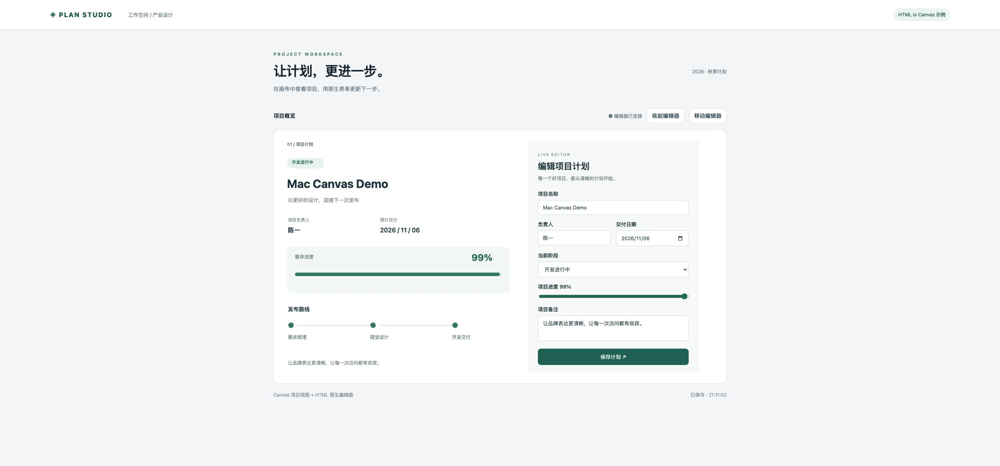

# HTML in Canvas 示例：Plan Studio

独立的项目计划编辑器，直接调用本仓库导出的 `zrender.createHTMLHost()`。
Canvas 展示项目名称、负责人、交付日期、进度和路线；HTML Host 承载原生表单。
保存表单会更新 Canvas；工具栏支持隐藏、恢复和移动 HTML 编辑器，表单内容保留。
数据仅保存在页面内存，刷新后恢复初始值。



## 启动

在仓库根目录执行（首次运行先 `npm ci`）：

```sh
npm --prefix examples/html-in-canvas start
```

打开 <http://127.0.0.1:8081>。启动时会重新构建本仓库的 `dist/zrender.js`。
无需安装示例自身的依赖。可用 `PORT=8082 npm --prefix examples/html-in-canvas start` 更改端口。

## 运行环境

在 Chrome 中打开 `chrome://flags/#canvas-draw-element`，设为 Enabled 并重启。
在同一个 Chrome 中访问示例；外部 Chrome 的设置不会应用于 Codex 内置浏览器。
要求原生 `layoutsubtree`、`drawElementImage`、`requestPaint`、
`updateElementGeometry`、`clearElementGeometry` 接口。
当前通过原生绘制探测和有限二维 DOMMatrix 检查准入，不再限定 Windows 或 Chrome 精确版本。
已在本机 macOS Chrome 中实测表单显示、编辑保存、移动及隐藏恢复。
真实 OS 中文输入法、其他浏览器和完整变换场景未在此示例中验证。
不兼容浏览器仍能显示 Canvas 项目概览，并显示无法启用表单的说明。

## 接入方式

1. 使用 Canvas renderer 初始化 zrender。
2. 调用 `createHTMLHost(zr, { x, y, width, height, z })` 获得 host。
3. 将应用表单挂到 `host.element`，再等待 `host.ready`。
4. 表单提交更新应用数据并重新绘制 Canvas；移动使用 `host.updateLayout()`。
5. 退出时先移除应用表单，再 `host.dispose()` 和 `zr.dispose()`。

示例所有 Canvas 图形都在 HTML Host 后面，使用同一普通图层，不使用裁剪、
渐进绘制、前景遮挡或导出，以符合当前封装的场景要求。

`app.js` 为业务逻辑，`style.css` 为页面及原生表单样式，`server.mjs` 为本地静态服务器。
